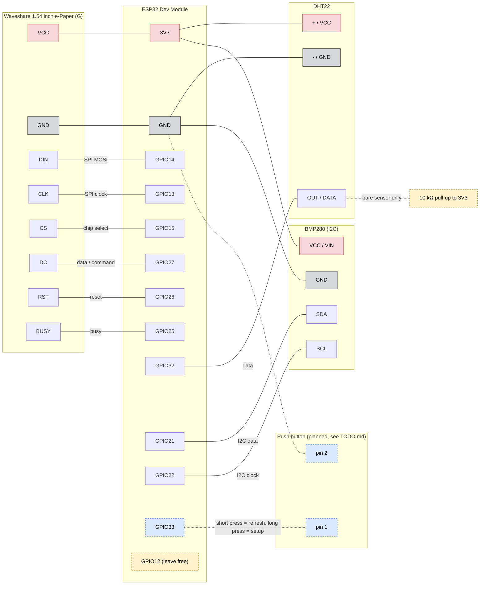

# ESP32 e-Paper Weather Station

A low-power weather station built on an ESP32 and a Waveshare 1.54" (G) 4-colour e-paper display.
It shows the current outdoor weather from an online forecast service together with indoor
temperature, humidity and air pressure from local sensors. Between updates the ESP32 deep-sleeps and the
panel is powered down, so the image stays on screen while drawing almost no power.

Current version: **0.9** (see [Version history](#version-history)).

## What it shows

- **Header:** city name on the left, date and time of the last successful update on the right
- **Weather icon** on the left, with the condition text (e.g. "Partly cloudy") to its right
- **Outdoor temperature and humidity**, without titles (the units say what they are)
- **FEELS:** "feels like" temperature, in whole degrees
- **WIND:** wind force in Beaufort (0-12 Bft). Open-Meteo has no Beaufort option, so the
  ESP32 converts it from km/h.
- **INDOOR** (boxed, with the word written vertically on the right): temperature and
  humidity from the DHT22, and below them the air pressure from the BMP280 in hPa
  (`--` for a sensor that can't be read). The pressure is converted to **sea level**, like
  weather reports, using the elevation Open-Meteo returns for the location. Until the first
  good update the raw value at the sensor is shown.

Numbers are black and their units (C, %, Bft, hPa) are red, so they are easy to tell apart.
The current weather takes the top half of the screen. The **bottom area** (below the
divider, 200×94 px) switches view on every refresh:

1. **3-day forecast:** today and the next 2 days, each with the day name, icon,
   max/min temperature, chance of rain and the day's highest wind force (Bft).
2. **Hourly graph:** temperature (red) and humidity (black) for the next 12 hours, with
   each one's min..max at the top and the hour every 3 hours along the bottom.
3. **Picture (optional, off by default):** an image from `bottom_image.cpp` (a sample
   picture at first; see [Custom picture](#custom-picture)). Turn it on with
   *Show the picture view* in the [setup portal](#setup-portal); while it is off, the
   rotation skips it.

### Screen layout

```
+------------------------------+
|ATHENS            07/10 21:45 |  black header: city, last update
|==============================|  yellow line
| (icon)  Partly cloudy        |  condition text
| (icon)  23.5C     65%        |  outdoor temperature, humidity
|                 +-----------+|
|FEELS   WIND     |22C 55%   I||  tile titles; indoor T/H
|21C     4Bft     |1013hPa   N||  values, units in red; pressure
|-----------------+-----------+|  divider (y 105) = bottom of the box
|  SAT   |   SUN    |   MON    |  bottom area, view 1: 3-day forecast
| (icon) |  (icon)  |  (icon)  |
| 24/15C |  22/14C  |  19/12C  |  max/min
|10% 3Bft| 60% 5Bft | 80% 2Bft |  chance of rain, max wind
+------------------------------+  (view 2: hourly graph, view 3: picture)
```

The bottom area is drawn by `drawBottom()` in the "bottom area" section of the `.ino`.
To add another view, add it to the `BottomView` enum, write a `drawBottom...()` function,
add a `case` in `drawBottom()` and list it in `BOTTOM_ROTATION`. To make it optional,
give it a flag bit in `settings.h`, a checkbox in the portal and a line in `viewEnabled()`.

### Custom picture

The picture is stored in `bottom_image.cpp` / `bottom_image.h`, which are generated by
`tools/img2epd.ps1` (Windows PowerShell, nothing to install). To use your own picture:

```
powershell -ExecutionPolicy Bypass -File tools\img2epd.ps1 -In C:\path\to\picture.png
```

The script scales the picture to fit 200×94 px, maps every pixel to the nearest of the 4
panel colours (black, white, yellow, red) and overwrites both files. Then upload the
sketch again. Simple flat-colour pictures (logos, drawings) work best; photos lose most
detail. `-Demo` recreates the sample picture.

## How it works

At power-up or reset (not when waking from deep sleep) it first opens the
[setup portal](#setup-portal) for 2 minutes.

Each time the ESP32 wakes up it:

1. Reads the indoor sensors (DHT22, BMP280).
2. Connects to WiFi and fetches current weather from [Open-Meteo](https://open-meteo.com/) (no API key needed).
3. Redraws the display, puts the panel to sleep, then deep-sleeps until the next update.

When the update fails (no WiFi or the API is unreachable):

- **After at least one good update:** the last known weather stays on screen and the
  update time in the header turns white on red.
- **If no data was ever fetched:** the header shows a red "No update", and "No data"
  appears next to a "?" icon. The indoor reading is still shown.
- **Retries back off:** each failure in a row waits one step longer (1, 2, 3 ... minutes,
  up to 15 steps), so a long outage doesn't drain the battery.
- **No needless refreshes:** while it keeps failing, the panel is only refreshed again
  if the indoor reading on screen would change. Each full refresh takes 15-20 s.

Values that must survive deep sleep (last weather, failure count, what is on screen) are kept in RTC memory.
A reset or power loss clears them. The settings from the setup portal (WiFi, location,
options) are kept in flash and are never cleared.

## Hardware

| Part | Notes |
|---|---|
| ESP32 dev board | "ESP32 Dev Module" (ESP32-WROOM-32) |
| Waveshare 1.54" e-Paper (G) | 200×200, black / white / yellow / red |
| DHT22 (AM2302) module | temperature and humidity |
| BMP280 module (I2C) | air pressure |
| Jumper wires, USB cable | |

## Wiring

GPIO numbers match the `Dxx` labels on most ESP32 dev boards.

Overview (the tables below are the exact reference; keep both in sync when a pin changes):



The blue dashed parts (push button on GPIO33) are planned and not in the firmware yet;
see "Push button" in `TODO.md`.

### e-Paper display

| e-Paper pin | ESP32 pin | Function |
|---|---|---|
| VCC  | 3V3 | 3.3 V |
| GND  | GND | |
| DIN  | GPIO14 | SPI MOSI |
| CLK  | GPIO13 | SPI clock |
| CS   | GPIO15 | chip select |
| DC   | GPIO27 | data / command |
| RST  | GPIO26 | reset |
| BUSY | GPIO25 | busy flag |

Set the **BS** jumper on the display board to **0** (4-line SPI). The pins are defined in `DEV_Config.h`.

### DHT22 sensor

| DHT22 pin | ESP32 pin | Note |
|---|---|---|
| + / VCC | 3V3 | Use 3.3 V, not 5 V, so the data line stays at a safe level |
| OUT / DATA | GPIO32 | Set by `DHT22_PIN` in `local_sensor.cpp` |
| - / GND | GND | |

Most DHT22 modules already have a pull-up resistor on the data line.
A bare 4-pin sensor needs about 10 kΩ between DATA and 3V3.

### BMP280 sensor

| BMP280 pin | ESP32 pin | Note |
|---|---|---|
| VCC / VIN | 3V3 | |
| GND | GND | |
| SDA | GPIO21 | Set by `BMP_SDA` in `local_sensor.cpp` |
| SCL | GPIO22 | Set by `BMP_SCL` in `local_sensor.cpp` |

The sketch tries I2C address 0x76 and 0x77 (set by the SDO pin on the module), and accepts
a BME280 too, since some boards sold as "BMP280" carry one. The sensor runs in forced
mode: it takes one reading when asked and then sleeps, so it draws almost nothing while
the ESP32 deep-sleeps. Module boards already have the I2C pull-up resistors.

### Pins to keep free

- **GPIO12:** leave unconnected. It is a strapping pin and can block boot or flashing.

## Software setup

1. **Get the code:** clone the repo or download the ZIP. The sketch is in the
   `ESP32_WEATHER_EPAPER/` subfolder. Open `ESP32_WEATHER_EPAPER/ESP32_WEATHER_EPAPER.ino`
   in the Arduino IDE. The outer folder can have any name.
2. **Arduino IDE** with the ESP32 board package (Espressif) installed.
3. **Libraries** (Library Manager):
   - `ArduinoJson` (v7)
   - `DHT sensor library` by Adafruit (also install `Adafruit Unified Sensor` when asked)
   - `Adafruit BMP280 Library` (also install `Adafruit BusIO` when asked)
4. **WiFi credentials and location:** set them from your phone with the
   [setup portal](#setup-portal), no code change needed. Optional: to build in a default
   WiFi, copy `secrets.example.h` to `secrets.h` in the sketch folder and fill it in.
   `secrets.h` is in `.gitignore`, so it is never committed.
5. **Settings** at the top of `ESP32_WEATHER_EPAPER.ino`:

   | Setting | Default | Meaning |
   |---|---|---|
   | `RETRY_MINUTES` | `1` | Base retry wait after a failure |
   | `MAX_FAIL_COUNT` | `15` | Maximum backoff steps |
   | `SETUP_PORTAL_SECONDS` | `120` | How long the WiFi setup portal stays open after power-up |
   | `DEBUG_LOG` | `1` | `1` = progress on the Serial Monitor (115200 baud), `0` = silent for battery use |

   The default location (used until the portal saves one) and the quick-fill buttons
   on the setup page are `LOCATION_PRESETS` in `settings.cpp`. The first entry is the default.
   The default refresh period (15 min) and its limits (3 to 1440 min) are `REFRESH_*` in
   `settings.h`.

6. **Board:** Tools → Board → *ESP32 Dev Module*, select the COM port, then Upload.

Keep the sketch folder named `ESP32_WEATHER_EPAPER`. The Arduino IDE needs it to match the `.ino` file name.

## Setup portal

After every power-up or press of EN (reset), the display shows a **WIFI SETUP** screen and
the ESP32 opens its own WiFi network for 2 minutes:

1. On your phone, join the WiFi network **`Weather-Setup`**, password **`44444444`**
   (also shown on the screen; change `SETUP_AP_PASS` in `wifi_setup.h`, at least 8 characters).
2. The setup page usually opens by itself. If not, open **http://192.168.4.1** in the browser.
3. Fill in the page (it shows the values stored now) and press **Save**.
   Press **Skip** to keep everything as it is and start right away.

The page has four parts:

| Part | Fields |
|---|---|
| **WiFi** | Network name and password. Leave the name empty to keep the current network. |
| **Location** | Name shown in the header (up to 10 plain ASCII characters, spaces at the ends are removed), latitude (-90 to 90) and longitude (-180 to 180). A **Fill in ATHENS** button fills in all three. |
| **Updates** | *Refresh every*: minutes between screen updates, 3 to 1440 (default 15). Waveshare recommends at least 3; longer means longer battery life. |
| **Bottom area** | *Show the picture view*: ticked = the picture is part of the rotation, not ticked (default) = it is skipped. |

The station then connects and shows the weather. If nobody connects within 2 minutes, it
continues with the saved settings. Everything is stored in the ESP32's flash (NVS), so it
survives deep sleep, resets and power loss. On/off options share one byte (`flags`, one
bit per option; bit 0 = picture view). Timer wake-ups from deep sleep never open the
portal, so it costs no battery in normal running.

The ESP32 only supports 2.4 GHz WiFi. If the password was wrong, press EN and set it again.

### Finding the latitude and longitude

- Open-Meteo's geocoding (free, no key): open this in a browser, with your place as `name`:
  `https://geocoding-api.open-meteo.com/v1/search?name=Athens&count=5&language=en&format=json&countryCode=GR`
  and copy `latitude` and `longitude` from the right entry (check `country` and `admin1`
  if several places share the name). `&countryCode=GR` is optional: it keeps only places in
  that country (2-letter ISO code, e.g. `IT`, `DE`, `US`). Leave it out to search all countries.
- Or Google Maps: right-click the spot; the first line of the menu is `lat, lon`
  (click it to copy).

The setup page shows the same link, but the `Weather-Setup` network has no internet, so
open the link on another device (or on the phone with mobile data) and type the numbers in.
Two decimals are enough (about 1 km); the sketch sends only two anyway. South and west are
negative, e.g. New York is `40.71`, `-74.01`.

## First start

1. Open the Serial Monitor at 115200 baud.
2. Press EN (reset) on the ESP32 and set up WiFi and the location as described above.
3. You should see the indoor reading, `WiFi connected`, `Fetch OK`, and then the panel
   refresh, which takes about 15-20 s.
4. The ESP32 then deep-sleeps for the refresh period set in the portal (default 15 min)
   and repeats.

**Troubleshooting**

| Symptom | Check |
|---|---|
| Upload fails with "Wrong boot mode" | Hold BOOT, tap EN, release BOOT, then upload again |
| `Indoor sensor read failed`, `--` on screen | DHT22 data wire on GPIO32, 3V3 power, pull-up resistor |
| `Pressure sensor not found`, `--hPa` on screen | BMP280 SDA on GPIO21, SCL on GPIO22, 3V3 power |
| Pressure a few hPa off from weather reports | Open-Meteo's elevation is for the area, not your floor: about 1 hPa per 8 m of height difference |
| `WiFi failed` | Press EN and re-enter WiFi name and password in the setup portal; the ESP32 only supports 2.4 GHz WiFi |
| Display stays blank | Wiring, BS jumper at 0, BUSY pin connected |

## Project files

All code is in the `ESP32_WEATHER_EPAPER/` sketch folder.

| File | Purpose |
|---|---|
| `ESP32_WEATHER_EPAPER.ino` | Main program: WiFi, fetch, layout, sleep and retry logic |
| `local_sensor.cpp/.h` | Indoor sensor reading (DHT22, BMP280) and sea-level conversion |
| `weather_icons.cpp/.h` | Weather icons drawn for each condition |
| `panel.h` | The one place that names the display: size, colours and panel calls |
| `wifi_setup.cpp/.h` | Setup portal (access point, web page, saving WiFi credentials and settings) |
| `settings.cpp/.h` | Stored settings: location, option flags, location presets |
| `bottom_image.cpp/.h` | Picture for the bottom area (generated, do not edit by hand) |
| `tools/img2epd.ps1` (repo root) | Converts a picture into `bottom_image.cpp/.h` |
| `secrets.example.h` | Template for the optional `secrets.h` (default WiFi credentials) |
| `EPD_1in54g.*`, `DEV_Config.*`, `GUI_Paint.*`, `font*.cpp`, `fonts.h` | Waveshare display driver and drawing library |
| `TODO.md` (repo root) | Planned improvements |

## Other displays

The sketch is set up for the 1.54" (G) panel: 200×200 pixels and 4 colours. To support
another Waveshare panel, swap the driver files and update `panel.h`, which holds the panel's
size, colours (`COL_WHITE`, `COL_BLACK`, `COL_RED`, `COL_YELLOW`) and init, display and sleep
calls. A panel with fewer colours maps the missing ones to a colour it has. Items at the right
and bottom edges follow `EPD_WIDTH` and `EPD_HEIGHT`, but fonts have a fixed size, so a much
smaller screen still needs layout changes. Also regenerate `bottom_image.cpp`, as it stores
the panel's raw colour codes.

## Version history

### 0.9
- The 3-day forecast shows each day's highest wind force in Beaufort next to the chance of
  rain. It comes from Open-Meteo's daily `wind_speed_10m_max`: sustained wind (not gusts)
  10 m above ground, the standard height the Beaufort scale is defined for, the same as
  the WIND tile. Today's column shows the day's peak, so it can be higher than the WIND
  tile, which is the wind right now. A missing value shows `--`.

### 0.8
- Wiring diagram (Mermaid) at the top of the Wiring section: e-paper, DHT22 and BMP280
  wired to the ESP32, power and ground colour-coded, GPIO12 marked as "leave free". The
  planned push button on GPIO33 is drawn dashed. Documentation only, no firmware change.

### 0.7
- The refresh period is set in the setup portal ("Updates" section) and stored in flash,
  instead of `REFRESH_MINUTES` in the code. Whole minutes, 3 to 1440; the default is
  15 min (`REFRESH_*` in `settings.h`). Out-of-range values are refused by the page and
  clamped when read from flash, so the panel never refreshes more often than every 3 min.

### 0.6
- Indoor air pressure from a BMP280 on I2C (GPIO21 / GPIO22), shown in hPa under the indoor
  temperature and humidity. It is converted to sea level with the elevation from Open-Meteo.
- The INDOOR tile is now a box with the title written vertically on its right side.
- A change in pressure also counts as "indoor changed" for the refresh-skip check while
  updates fail.
- The forecast view shows today and the next 2 days (was tomorrow and the 2 days after).

### 0.5
- Location (name, latitude, longitude) is set in the setup portal and stored in flash,
  instead of `CITY` / `LAT` / `LON` in the code. The name is limited to 10 characters and
  trimmed. A "Fill in ATHENS" button fills in the default (presets in `settings.cpp`).
- The setup page links to Open-Meteo's geocoding search for finding the coordinates.
- The picture view in the bottom area is optional: a checkbox in the setup portal, off by
  default. On/off options are stored as bits of one `flags` byte (bit 0 = picture view).
- One Save button for all settings; an empty WiFi name keeps the current network.
- The header shows "No update" instead of "Update failed" when no weather was ever fetched,
  so it doesn't cover a 10-character name.

### 0.4
- Centralized panel dimensions, colour names and init/display/sleep calls in `panel.h`,
  making it easier to adapt the sketch to other e-paper displays.
- Updated drawing code to use the shared colour names and panel dimensions where possible.

### 0.3
- Compact screen layout: the weather now fits in the top half, leaving about half of the
  screen free (below a divider) for more information later.
- Weather icon on the left with the condition text beside it.
- Feels, Wind and Indoor are shown as titled tiles. Temperature and humidity have no titles.
- Wind is shown in Beaufort (Bft) instead of km/h.
- Units (C, %, Bft) are drawn in red so they stand out from the numbers.
- The last-update time moved into the header. It turns red when updates fail.
- The bottom area alternates on every refresh between a 3-day forecast, an hourly temp/hum graph and a picture.
  The picture comes from `bottom_image.cpp`, made with the new `tools/img2epd.ps1` converter.

### 0.2
- WiFi setup portal: after power-up or reset the ESP32 opens the `Weather-Setup` network
  for 2 minutes, so the WiFi name and password can be set from a phone. They are saved in
  flash (NVS), so `secrets.h` is now optional.
- The sketch moved into the `ESP32_WEATHER_EPAPER/` subfolder, so a clone or ZIP opens
  directly in the Arduino IDE.

### 0.1
- First version: current weather from Open-Meteo with condition icons, indoor temperature
  and humidity from a DHT22, and deep sleep between updates.
- When an update fails, the last good weather stays on screen with a red status, and
  retries back off step by step.
- WiFi name and password set in `secrets.h`.
